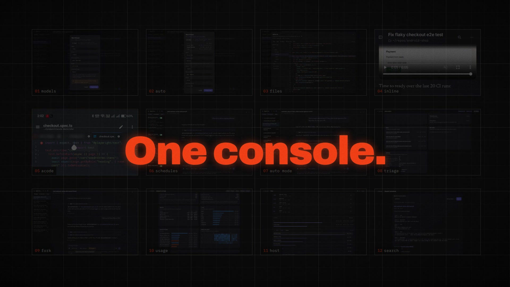

# agent-console

[](https://youtu.be/JNqju6qvxvc)

[Watch the 2-minute tour](https://youtu.be/JNqju6qvxvc) · Claude Code, Codex, and Pi, from your laptop or phone: auto-picked models, files, inline media, Acode, schedules, Auto mode from GitHub issues, triage, cross-agent forks, usage and host dashboards, search.

Browser front end for Claude, Pi, and Codex agents running on this machine. No remote desktop. Installable as a PWA.

**Personal use only** — never share this instance. Anthropic's terms restrict third-party products built on claude.ai login.

## Start here (2 minutes)

1. `npm install`
2. `bin/agent-console start` — listens on `127.0.0.1:7070`
3. `bin/agent-console url` — get the console URL (HTTPS)
4. `bin/agent-console password` — get your sign-in password (generated once, stored at `~/.config/agent-console/password`)

Open the URL, sign in, create a thread. You're running.

## What you can do

**Agents.** Claude Code, Pi (any model Pi supports: OpenRouter, OpenAI, Google, local), Codex. Pick one per thread; switch by creating a new thread.

**Threads.** Each thread is its own resumable agent session. Streaming output, markdown, tool cards with diffs. Per-thread model and permission mode: plan / accept edits / bypass. Bypass is opt-in and confirmed.

**Composer.**
- Type `/` for a command/skill menu. Tab, Enter or tap to complete; Enter submits on mobile too.
- Attach files with paste (Ctrl/Cmd+V), drag, or the attach button. Up to 8 files, 25 MB each. Images are downscaled to 2000px.
- Enter while an agent works **queues** the message; **Steer** (or Alt+Enter) hands it to the running turn immediately.
- Queued messages can be edited; edits persist across restarts in `queues.json`.

**Ask questions mid-turn.** Agents can pause and show an inline card with choices or a text field. The sidebar marks threads that need input. Answers stay in the transcript.

**[Session search](docs/session-search.md).** Local BM25 search across every provider, including archives and tool output. Search icon in the sidebar. Within a thread: header button, ⋯ menu, or Ctrl/Cmd+F.

**File viewer.** Click any file path or image in a message. Syntax highlighting, line references (`server/threads.ts:360`), copy, wrap toggle. **Edit** opens text files in Acode and saves back. See [Acode setup](docs/acode-editing.md).

**Scheduled tasks.** Sidebar → **Scheduled**. Saved prompts that run on a timer: Manual, Hourly, Daily, Weekdays, or Weekly. Pi is default; Claude and Codex work too. Each run is an ordinary thread. Reports commit to `~/repos/agent-outputs/<task>/<date>-<time>.md`. A run never overlaps the previous one. After downtime, one catch-up run covers the latest missed window within 7 days.
**App ideas.** Sidebar → ⋯ → **App ideas**. A list of app ideas kept in a private git repo (`~/repos/app-ideas`, override with `AGENT_CONSOLE_IDEAS`) as `index.md` plus one `<app>.md` of features each. Adding an idea commits both files, and pushes when the branch tracks a remote. See [docs/app-ideas.md](docs/app-ideas.md).

**Thread actions (⋯ menu).** Rename, Fork, Download (Markdown), Share, Delete. Fork continues from this session: Claude forks its real session, Pi copies its directory, Codex uses the transcript as context. Refused while a turn is running.

**Notifications.** Sidebar → **Notifications** → Enable. Push alerts when a thread finishes, fails, or needs input — even when the app is closed. Requires HTTPS or localhost. On iOS, use the installed Home Screen app.

**[CI cost and local hook](docs/ci.md).** Measured CI minutes, keep/move/remove decision per step, and the opt-in `.githooks/pre-commit` that runs `npm test` before a commit.

**[Automatic GitHub triage](docs/github-triage.md).** Labels issues and PRs by effort and priority via a signed webhook. Token telemetry comments per issue/PR; the `telemetry-comment` CI check fails a PR without one. Backfill with `bin/token-telemetry backfill`.

**Usage & savings** (`/dashboard`). Today / 7 / 30 / 90 days, previous-period comparison. Turns, tokens, API-equivalent cost, RTK and Headroom savings, per-day charts, model/tool/thread breakdowns, weekday-by-hour heatmap.

**Model benchmarks** (`/benchmarks`, also in the sidebar menu). Compare Artificial Analysis intelligence, coding and agentic scores against your last seven days of measured token usage. Set a quality floor and budget, then compare weekly and monthly API costs at 16 hours per day, seven days per week. Cached views make no external requests. Weekly refresh runs Mondays at 08:00 UTC while the server is running; manual refresh has a one-hour cooldown. The server follows quota headers, respects `Retry-After`, keeps ten requests in reserve and replaces the snapshot only after all pages succeed.

Keep the API key in `artificial-analysis.key` inside `AGENT_CONSOLE_DATA` (default `~/.config/agent-console`), with permissions `0600`, or set `ARTIFICIAL_ANALYSIS_API_KEY` in the server environment. Never put the key in this repository or browser code. The snapshot, quota state and weekly preference stay in the data directory. Projections use fully measured completed turns and the union of their active intervals; incomplete coverage is disclosed. API equivalents and cache scenarios do not establish subscription charges, quota sufficiency or guaranteed productivity. Run `npm run test:benchmarks`; browser checks use `BASE=<scratch-url> AGENT_CONSOLE_DATA=<scratch-data> node test/benchmarks-ui.ts` with a cached snapshot.

The benchmark dashboard shows your two Claude account fees and Codex fee separately from API alternatives. Edit these fees on the page; they are saved privately in `benchmark-subscriptions.json` in the data directory, never in the repository. Cached per-account quota percentages include sample timestamps and reset times; old or expired samples stay marked stale. They do not establish coverage for 112 productive hours per week. The optional API workload share starts unknown; entering a share estimates additional API spending plus fixed fees using the same measured token mix. It does not convert quota percentages into token budgets or predict a bill.

**Context efficiency.** Sidebar context meter shows how full the window is (amber as it fills). Click it to compare continuing vs compacting: cumulative cost graph, scenario controls. `/compact` (or ⋯ → Compact context) compacts; messages typed during compaction queue. Compaction is suggested from 70% full; idle auto-compaction runs once per cycle above 50,000 tokens.

**Auto titles.** Threads rename themselves from the first message. Every 3-word-plus prompt renames again from the last two messages (unless you chose the title). Powered by NVIDIA Nemotron → OpenRouter free, never blocks the turn.

**Readable tool cards.** Bash cards show what a command is *for*, not the raw command. `AGENT_CONSOLE_LABELS=0` to disable.

**Attachments detail.** Images go to the model as vision input; other files are listed by absolute path and the agent opens them with its own tools. Claude gets `--add-dir` for the upload folder in Plan/Accept-edits mode.

## Install as an app

Open the console URL in Chrome → address-bar install icon (or ⋮ → Cast, save and share → Install page as app; Android: ⋮ → Install app). Own window, launcher icon, maskable Android icon. Regenerate icons: `npm run icons`.

This instance uses [console.nefro-dev-coder.duckdns.org](https://console.nefro-dev-coder.duckdns.org/).
Coder still provides GitHub SSO and workspace management. See [URL routing, rollout, and rollback](docs/console-url.md).
Set `AGENT_CONSOLE_URL` in the environment or Console environment file to make the URL command print an authenticated alias; otherwise it uses `VSCODE_PROXY_URI`.

## Security model

- Binds to `127.0.0.1` only; access through Coder's authenticated port proxy.
- **Coder SSO:** when `VSCODE_PROXY_URI` is set, requests matching this app's Coder hostname are trusted. Direct localhost hits still need the password. Keep the port share level on "owner". Disable SSO with `AGENT_CONSOLE_AUTH=password`; add trusted hosts with `AGENT_CONSOLE_PUBLIC_HOST`.
- Password login → signed HttpOnly/Secure/SameSite=Strict cookie; failed-login limiter.
- WebSocket requires the cookie **and** a matching Origin header.
- Thread folders are restricted to your home directory.
- `ANTHROPIC_API_KEY` is stripped from the child environment; subscription login cannot be swapped for metered billing.
- **Bypass mode** means a prompt can run any command as this user. Treat the password like a shell login.

## Providers

Headroom proxy defaults remain conservative: Kompress disabled, fallback disabled,
CCR disabled, one worker. To opt into tested Kompress, set
`AGENT_CONSOLE_HEADROOM_KOMPRESS=1`. `AGENT_CONSOLE_HEADROOM_COMMAND` selects the
executable (default `headroom`); it can point to a specific virtual environment.

| Agent | How it runs | Login | Modes |
| --- | --- | --- | --- |
| Claude Code | `claude -p` stream-json, long-lived process | your Claude subscription | plan / accept edits / bypass |
| Pi | `pi --mode rpc`, long-lived, any model in `pi --list-models` | API key or `pi /login` | plan / bypass (no approval prompts) |
| Codex | `codex app-server`, persistent per session | `codex login --device-auth` | plan / accept edits / bypass (bypass-only where sandbox is blocked) |
| Mock | scripted, offline | none | all |

Credentials for non-Claude agents: `~/.config/agent-console/env`, then `~/openrouter/.env`. Override with `AGENT_CONSOLE_ENV_FILES` (colon-separated). `OPEN_ROUTER_TOKEN` is an alias for `OPENROUTER_API_KEY`.

OpenRouter free tier: 50 requests/day (1000 after a one-off $10 credit). Use the mock for routine tests.

### Two Claude accounts, one brain

Choose **Sunny** or **Nefro** in the new-thread dialog. Usage tabs keep quotas separate.

Set up Nefro:

```sh
bin/claude-account nefro login
```

Complete the browser login with `nefro.amit.roy@gmail.com`, then reload the Console.

Check status: `bin/claude-account sunny status` or `bin/claude-account nefro status`.

Both profiles share instructions, settings, skills, and agents via symlinks. Credentials and sessions are never copied.

### NVIDIA NIM (direct)

1. Add `NVIDIA_API_KEY=...` to `~/.config/agent-console/env`.
2. Run `bin/agent-console restart-when-idle` (model list loads at server start).
3. In the New thread dialog, pick Pi and a model with subtitle starting `nvidia ·`.

Picker subtitles: `nvidia · nvidia` = direct NIM; `openrouter · nvidia · free` = same model via OpenRouter.
If a key lists a model that returns `404 Function … Not found for account`, pick another model. Free tier: ~40 requests/min.

### Shared brain

All agents use the same brain wiki at `~/repos/brain` (`AGENT_CONSOLE_BRAIN` to override). Claude reaches it via user hooks; Pi and Codex receive it as an injected system prompt. After every turn the server runs `brain commit`. After `BRAIN_NUDGE_AFTER` (default 12) tool calls with no wiki write, a reminder turn fires automatically (`BRAIN_NO_NUDGE=1` to silence).

### Adding an agent

Implement `Provider` (`server/providers/types.ts`), emit events through `ctx.event`, register in `server/providers/index.ts`, add fixtures to `test/providers.ts`.

## Test

```sh
node test/providers.ts   # offline: adapter translators, env files, model table
npm test                 # providers + end-to-end (needs AGENT_CONSOLE_MOCK=1 server)
REAL=1 npm test          # also one real Claude turn (uses subscription quota)
npm run test:ui          # Chromium: themes, viewports, menus, contrast, PWA
```

Scratch instance (no impact on your threads):

```sh
BRAIN_NUDGE_AFTER=2 AGENT_CONSOLE_MOCK=1 AGENT_CONSOLE_DATA=/tmp/ac-test PORT=7071 node server/index.ts &
BASE=http://127.0.0.1:7071 AGENT_CONSOLE_DATA=/tmp/ac-test PORT=7071 npm test
```

Kill it by pid. `pkill -f server/index.ts` also kills your real server (it runs `node .bundle/server/index.ts.mjs`, a bundle that `bin/agent-console` rebuilds whenever a source is newer).

CI time budget: the "Test time budget" step fails when one test file takes over 15 s or the whole `npm test` pool takes over 25 s on the 4-CPU runner. The run summary lists the slowest files. Keep new tests cheap: add cases to an existing UI file instead of a new file that starts its own server and Chromium, and wait on conditions instead of fixed sleeps.

Isolated checks: `node test/latency.ts`, `node test/history-wire.ts`, `npm run test:transport`, `npm run test:cache`, `npm run test:queue-ui`, `npm run test:files`.

## Layout

```
server/          Node 24, TypeScript (native type stripping, no build)
server/providers/ one adapter per agent (claude.ts, pi.ts, codex.ts, mock.ts)
server/threads.ts harness-agnostic turn/thread management
public/          vanilla ES modules: app.js, menu.js, render.js
bin/agent-console process control
```

## Restarting after a turn

`bin/agent-console restart-when-idle` — returns immediately, starts a detached watcher. Waits until no thread is running (plus 1.5 s quiet), then stops and starts the server. Browsers reload themselves unless the composer holds a draft (a banner asks first). Use this as the last step of any turn that touches `server/` or `public/`. Never stop/start mid-turn.

`bin/agent-console restart` — immediate stop/start (no idle wait).

## Lean context

Claude threads start at ~19k tokens of fixed context: MCP servers ~3.5k, skills + slash-command lists ~6.6k, core prompt ~8k. Only the built-in `agent_console` MCP server loads by default; agents use the `codegraph` CLI (`AGENT_CONSOLE_MCP=name,name` or `all` adds servers from `~/.claude.json`). Idle agent processes exit after 30 min (`AGENT_CONSOLE_IDLE_MS`).

## Type and assets

All self-hosted. No CDN. No asset requests leave `127.0.0.1`.

- **Newsreader** variable (conversation text, 18px/1.6), **Inter** variable (UI chrome), **JetBrains Mono** variable (code, ligatures off) — SIL OFL 1.1.
- **highlight.js** 11 (BSD-3-Clause), 13 languages.
- `npm run vendor` re-copies fonts and highlight.js from node_modules (copies are committed).
- Design tokens at the top of `public/style.css`; contrast asserted by `npm run test:ui`.
